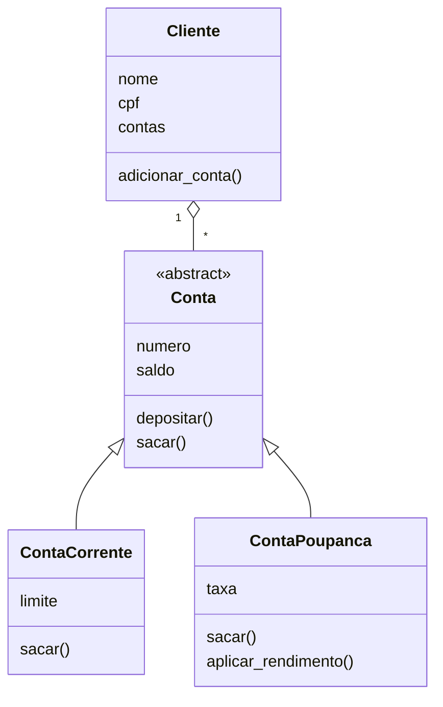

# Sistema Bancário

## Objetivo

Criar um sistema bancário utilizando programação orientada a objetos em Python.

## Classes

- Conta: classe abstrata com saldo, depósito e saque.
- ContaCorrente: permite utilizar um limite adicional.
- ContaPoupanca: permite aplicar rendimento.
- Cliente: armazena os dados do cliente e suas contas.

## Conceitos utilizados

- Encapsulamento com propriedade para consultar o saldo.
- Herança com ContaCorrente e ContaPoupanca.
- Polimorfismo com o método sacar.
- Classe abstrata usando ABC e abstractmethod.
- Tratamento de exceções com ValueError.
- Métodos especiais __init__ e __str__.

## Diagrama



## Execução

Execute o arquivo main.py:

```bash
python main.py
```
